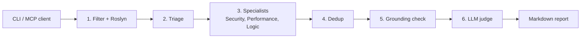

# Multi-Agent Code Review

A multi-agent code review pipeline for C# repositories, built on Microsoft AutoGen against Groq's OpenAI-compatible API. Specialist agents review the diff of a commit, deterministic stages merge and verify what they found, and the result is a markdown report. It runs as a CLI and as an MCP server (stdio or HTTP).

## Results

Measured against what human reviewers wrote on 12 merged pull requests, the pipeline's findings rarely coincide with the comments: macro F1 0.057 (95% interval 0.00 to 0.14), 3 of 41 findings matching and 3 of 28 comments matched. The fixes made after the first run did not produce a visible gain, and the matcher is lexical and unvalidated. The benchmark's real output is the list of failure modes it exposed. Read [benchmarks/README.md](benchmarks/README.md) before quoting any number.

## Architecture



| Stage | What it does | Where |
|-------|--------------|-------|
| Filter | Git diff and Roslyn dependency graph, source files only. Also runs Roslyn complexity, call-site and code-smell analysis on the methods the diff touches | `FilterStage.cs`, `ChangeAnalyzer.cs` |
| Triage | A small model classifies the diff and picks 1 to 3 specialists | `TriageAgent.cs` |
| Specialists | Up to 3 agents run via `Task.WhenAll`, started 15 s apart for Groq's free-tier limits. Each sees a fair-share window of the diff (6,000 characters, whole lines only, omissions named) with absolute line numbers injected | `SpecialistAgents.cs` |
| Dedup | Plain C#: merges findings on the same file and line (keeping the most severe) and near-duplicates with no line number | `CodeReviewPipeline.cs` |
| Grounding | Deterministic check that the code each finding quotes exists in the commit. No LLM call | `GroundingStage.cs` |
| Judge | An LLM scores each finding 1 to 3 on relevance, severity accuracy and actionability. Totals below 5/9 are flagged low-confidence and listed in a separate section. Fails open | `EvaluationStage.cs`, `EvalAgent.cs` |

Two more agents run outside the pipeline: Onboarding answers questions (`ask`) and Documentation writes docs (`docs`). The `review_repo` MCP tool also appends a quick modernization scan.

Default models are `openai/gpt-oss-20b` for triage, onboarding and the quick scan, and `openai/gpt-oss-120b` for specialists. The judge uses `MODEL_EVAL`, else the synthesis model. Groq retires models regularly and a role pointing at a retired one fails with a 404, so pin the ones you rely on with `MULTIAGENT_MODEL_<ROLE>`.

### Projects

| Project | Purpose |
|---------|---------|
| `Core` | Models, interfaces, configuration, prompts |
| `Agents` | AutoGen agents and `AgentFactory` |
| `Orchestration` | Pipeline, DI, Git and Roslyn tools, benchmark harness |
| `Host` | CLI (`review`, `ask`, `docs`, `bench`, `bench-compare`, `bench-summary`) |
| `McpServer` | MCP server, stdio or HTTP |
| `Tests` | xunit suite, 243 tests |

## Engineering decisions

- **Models generate; deterministic code decides.** Only triage, the specialists and the judge call a model. Dedup, severity ordering, line numbering, the grounding check and the benchmark matcher are plain C# with unit tests.
- **Failures are visible.** A timed-out or flaky agent is retried (timeouts, 429, 502/503/504) with backoff. If it still fails, the report opens with an "Incomplete review" banner. Errors retrying cannot fix, such as a bad key or a retired model, fail loudly. Verification stages flag findings into a separate section instead of dropping them.
- **MCP input is untrusted.** `commit_hash` and `base_commit` become `git` arguments, so refs are validated first (a ref starting with `-` would be parsed as an option). The CLI reads only `MULTIAGENT_`-prefixed configuration, so an unrelated `API_KEY` cannot replace the Groq key.
- **Context is budgeted.** Specialists get a fair-share window of the diff plus a few hundred tokens of Roslyn facts about only the methods the diff touches.
- **Cost is measured.** Tokens are counted per review from each response's `usage` field, scoped with `AsyncLocal` so concurrent reviews do not mix counts. `bench` can record generations and replay only the verification stages, so a judge comparison costs a few thousand tokens instead of a full run.
- **Tested without a network.** `dotnet test` runs the diff parser against real temporary git repositories and the whole pipeline against a fake OpenAI-compatible server. Both deploy workflows gate on it.
- **No long-lived cloud keys.** GitHub Actions assumes an AWS role through OIDC and deploys over SSM, with no SSH and secrets in Parameter Store.

### What the verification stages prove

- **Grounding** catches fabricated or misquoted code. It checks that the quoted code exists, not that the claim about it is true, so a wrong claim about real code passes.
- **The judge** is an LLM, so its scores are opinions, and a judge of the same model or family as the generators tends to be lenient. The report says whether the judge is the same model, the same family or a different family. Its scores have not been validated against labelled data.

### Static analysis limits

Callers are found within the same file only, because the tool builds a one-file compilation. Complexity and callers are skipped for overloaded method names. At most 20 files and 25 methods are analysed per review. Turn it off with `MULTIAGENT_STATIC_ANALYSIS=false`.

## Quick start

```bash
git clone https://github.com/bhavyananda17/multi_agent_code_review_mcpserver.git
cd multi_agent_code_review_mcpserver
dotnet build
cp .env.example .env     # add GROQ_API_KEY

dotnet run --project MultiAgentCodeReview.Host -- review <repo-path> <commit-hash> [base-commit] [--issue <url|number>]
dotnet run --project MultiAgentCodeReview.Host -- ask <repo-path> <commit-hash> "where is auth handled?"
dotnet run --project MultiAgentCodeReview.Host -- docs <repo-path> <commit-hash> [base-commit]
```

`--issue` fetches a GitHub issue (public repos need no token; set `MULTIAGENT_GITHUB_TOKEN` for private ones) so triage and file ranking favour what it describes.

### MCP server

| Tool | Use it to |
|------|-----------|
| `review_repo` | Review a commit or PR: filter, triage, specialists, dedup, grounding, judge |
| `ask_codebase` | Ask a question such as "what calls X?" |
| `generate_docs` | Generate README, API and architecture docs |

`repo_path` can be a local path or a git URL. Setup for stdio and HTTP is in [MCP_SETUP.md](MCP_SETUP.md).

## Benchmarking

`bench` runs the full pipeline over a CSV of real commits and scores its findings against the human review comments on them.

```bash
dotnet run --project MultiAgentCodeReview.Host -- bench prs.csv [--out results.json] [--md summary.md] \
    [--threshold 0.25] [--one-to-one] [--include-low-confidence] [--record <dir> | --replay <dir>]
dotnet run --project MultiAgentCodeReview.Host -- bench-compare before.json after.json
```

- **Input:** one row per PR with `repo_url`, `commit_sha` and `findings` (human findings separated by `|`, newlines or a JSON array). Every row is validated before anything runs.
- **Matching:** both sides are tokenised (lower-cased, stop-words removed, stemmed, camelCase aware) and compared with the Dice coefficient (default threshold 0.25, at least 2 shared tokens). Precision, recall and F1 are reported per PR and as macro and micro averages with 95% bootstrap intervals.
- **Comparing runs:** `bench-compare` reports the paired difference with a bootstrap interval and an exact sign-flip p-value, and says when a difference cannot be told apart from noise.
- **Record and replay:** `--record` saves what the specialists found; `--replay` reruns only grounding and the judge on those findings, so a judge comparison is properly paired and spends only the judge's tokens.

Matching is lexical overlap, not understanding. It misses paraphrases and can pair unrelated comments. Details, results and threats to validity are in [benchmarks/README.md](benchmarks/README.md).

## Configuration

Environment variables, prefix `MULTIAGENT_` (see `.env.example`):

| Variable | Description | Default |
|----------|-------------|---------|
| `GROQ_API_KEY` | Required Groq key | none |
| `GROQ_BASE_URL` | OpenAI-compatible endpoint | `https://api.groq.com/openai` |
| `MODEL_<ROLE>`, `_TEMP`, `_TOKENS` | Model, temperature and max tokens per role | per role |
| `MODEL_EVAL` | Judge model. Use a different family from the generators | synthesis model |
| `GROUNDING_ENABLED` | Verify quoted code exists | `true` |
| `STATIC_ANALYSIS` | Roslyn context for the specialists | `true` |
| `EVAL_ENABLED` | Run the judge | `true` |
| `EVAL_THRESHOLD` | Total below this (0 to 9) is low-confidence | `5` |
| `EVAL_EXCLUDE_LOW_CONFIDENCE` | `true` drops flagged findings, `false` lists them separately | `false` |
| `EVAL_BATCH_SIZE` | Findings per judge call | `8` |
| `AGENT_TIMEOUT_SECONDS` | Per-attempt limit for each agent and the judge | `180` |
| `GITHUB_TOKEN` | Only for `--issue` on private repos | none |

## Performance

On the 12-PR benchmark (Groq free tier): 6 to 84 s per PR (mean about 41 s) and about 12.6k tokens per PR. A review makes one triage call, up to three specialist calls and one judge call per eight findings. On the free tier, throttling rather than computation dominates wall time.

## Deployment

`.github/workflows/deploy-mcp-aws.yml` builds, tests and deploys the MCP server over HTTP to AWS (EC2, ECR, SSM, OIDC, `X-Api-Key` auth). Last deployed 2026-10-31 from `main`. The instance is started and stopped by hand to avoid cost, so an endpoint is not always up, and its public IP changes on each start. The workflow can also be run manually.

## Known gaps

- A false claim about real code passes verification. Grounding checks that quoted code exists, and the judge did not catch the one false `Critical` pair examined by hand. The specialists see a window of the diff, not the enclosing method signature, which is a likely cause.
- The judge's scores and the benchmark matcher are unvalidated, and the benchmark is 12 hand-picked PRs.
- Call-site analysis is same-file only, and only C# is supported (`FilterStage` drops other extensions).
