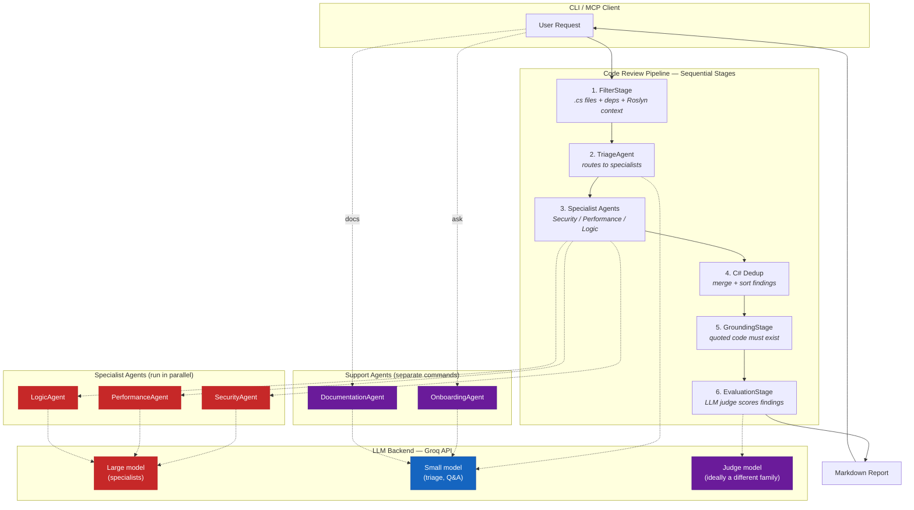
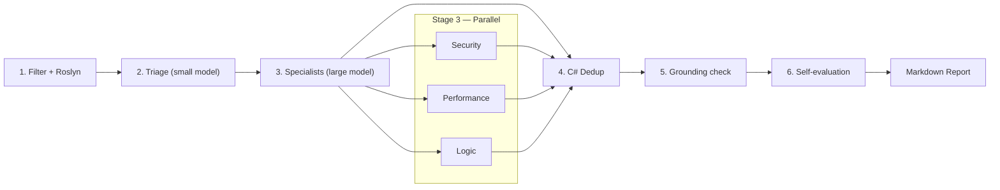
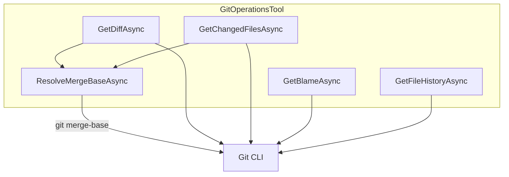
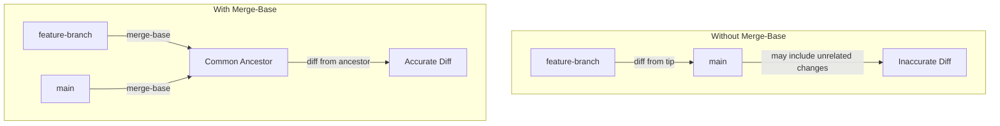
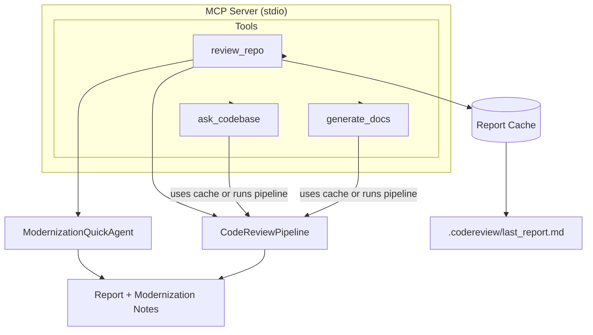
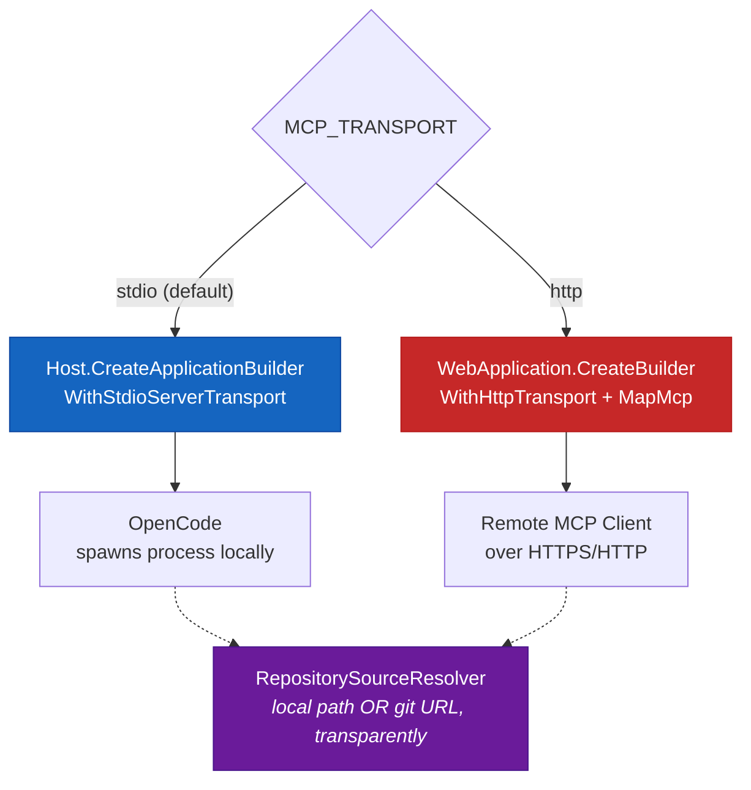
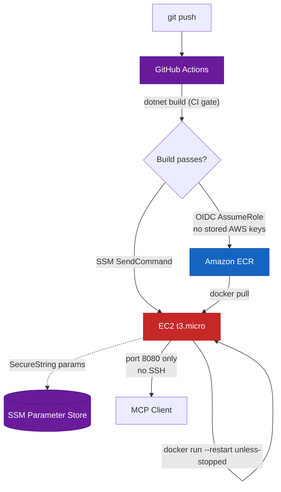

# Multi-Agent Code Review System

> **Intelligent, automated code review powered by multi-agent AI**

A multi-agent code review pipeline for C# repositories, built on Microsoft AutoGen against Groq's OpenAI-compatible API. Specialist agents review the diff of a commit, deterministic stages merge and verify what they found, and the result is a markdown report. It runs as a CLI, as an MCP server (stdio or HTTP) and as a small REST API. This README describes how it is built; what it was measured to do, and where it falls short, is in [benchmarks/](benchmarks/README.md).

---

## Architecture



---

## Engineering decisions

- **Models generate; deterministic code decides.** Only triage, the three specialists and the judge call a model. Dedup, severity ordering, diff line numbering, the grounding check and the benchmark matcher are plain C# with unit tests.
- **Failures are visible, never silent.** A timed-out or flaky agent is retried, and if it still fails the report opens with an "Incomplete review" banner. Errors retrying cannot fix (bad key, retired model) fail loudly. Verification stages flag findings into a separate section instead of dropping them.
- **Input from MCP clients is untrusted.** `commit_hash` and `base_commit` become `git` arguments, so refs are validated before use (a ref beginning with `-` would be parsed by git as an option). The CLI reads only `MULTIAGENT_`-prefixed configuration, so an unrelated `API_KEY` in the environment cannot replace the Groq key.
- **Context is budgeted.** Specialists get a fair-share window of the diff (cut at line boundaries, omissions named) plus a few hundred tokens of Roslyn facts about only the methods the diff touches.
- **Cost and reproducibility are built in.** Tokens are counted per review from each response's own `usage` field, scoped with `AsyncLocal` so concurrent reviews do not mix counts. `bench` can record generations and replay only the verification stages, so a judge comparison costs a few thousand tokens instead of a full run.
- **Tested without a network.** `dotnet test` runs the git diff parser against real temporary repositories and the whole pipeline against a fake OpenAI-compatible server. Both deploy workflows gate on it.
- **Deploys hold no long-lived cloud keys.** GitHub Actions assumes an AWS role through OIDC and deploys over SSM, with no SSH and with secrets in Parameter Store.

---

## System Architecture

### Project Dependency Graph

```
MultiAgentCodeReview.Core          (no dependencies)
    ↑
MultiAgentCodeReview.Agents        (references Core)
    ↑
MultiAgentCodeReview.Orchestration (references Core + Agents)
    ↑
    ├── MultiAgentCodeReview.Host        (references Orchestration)
    └── MultiAgentCodeReview.McpServer   (references Orchestration + Agents)
```

> **Note:** every project, including `MultiAgentCodeReview.McpServer` and `MultiAgentCodeReview.Tests`, is in `MultiAgentCodeReview.slnx`: `dotnet build` and `dotnet test` at the repo root cover everything.

### Projects

| Project | Purpose | Key Files |
|---------|---------|-----------|
| `MultiAgentCodeReview.Core` | Domain models, interfaces, config, prompts, rate limiting | `IAgent.cs`, `Finding.cs`, `PipelineContext.cs`, `AgentPrompts.cs` |
| `MultiAgentCodeReview.Agents` | AutoGen agents (Triage, 3 Specialists, Docs, Onboarding) | `TriageAgent.cs`, `SpecialistAgents.cs`, `AgentFactory.cs` |
| `MultiAgentCodeReview.Orchestration` | DI container, pipeline orchestrator, Roslyn/Git tools | `CodeReviewPipeline.cs`, `FilterStage.cs`, `GitOperationsTool.cs` |
| `MultiAgentCodeReview.Host` | Console entry point (CLI commands) | `Program.cs` |
| `MultiAgentCodeReview.McpServer` | MCP server exposing tools via stdio transport | `Program.cs`, `CodeReviewMcpTools.cs` |

---

## Agents

| Agent | Role | Default model |
|-------|------|---------------|
| **Triage** | Classifies changes, routes to specialists | `openai/gpt-oss-20b` |
| **Security** | SQLi, XSS, auth bypass, crypto, secrets | `openai/gpt-oss-120b` |
| **Performance** | N+1, blocking calls, memory, O(n²), caching | `openai/gpt-oss-120b` |
| **Logic** | Logic errors, SOLID violations, complexity, code smells | `openai/gpt-oss-120b` |
| **Eval (judge)** | Scores each finding 1–3 on relevance, severity accuracy, actionability | the `MODEL_EVAL` model, else the synthesis model |
| **ModernizationQuick** | Quick-scan for outdated patterns, old packages, legacy APIs (uses the onboarding model) | `openai/gpt-oss-20b` |
| **Documentation** | Generates README, API docs, Architecture | `openai/gpt-oss-120b` |
| **Onboarding** | Answers developer questions from codebase context | `openai/gpt-oss-20b` |

Defaults are models Groq lists today. Groq retires models regularly and a role pointing at a retired model fails with a 404 (triage has no fallback), so pin the models you rely on with `MULTIAGENT_MODEL_<ROLE>`. List what your key can use with `curl -s https://api.groq.com/openai/v1/models -H "Authorization: Bearer $GROQ_API_KEY"`.

---

## Pipeline Stages



### Stage Details

| Stage | What it does | Key implementation |
|-------|-------------|-------------------|
| **Filter** | Git diff + Roslyn dependency graph → source files only; also runs Roslyn complexity / call-site / code-smell analysis on the methods the diff touches | `FilterStage.cs`, `ChangeAnalyzer.cs` — excludes `.md`, `.json`, `.xml`, etc. |
| **Triage** | A small model classifies the diff and routes to 1-3 specialists | `TriageAgent.cs` — outputs `{"selected_agents":[...]}` |
| **Specialists** | Up to 3 agents launched in parallel via `Task.WhenAll`, staggered 15s apart, each seeing a fair-share window of the diff (6,000 characters shared across files, whole lines only, omissions named) | Staggered to respect Groq free-tier rate limits; `BaseSpecialistAgent.BuildDiffContent` |
| **Dedup** | C# code merges findings on the same file and line (keeping the most severe), and merges near-duplicate findings that have no line number | `CodeReviewPipeline.cs` — no LLM call needed |
| **Grounding** | Deterministic check that the code each finding quotes actually exists in the commit (or in the diff, for removed lines); a finding quoting code that is not there is flagged. No LLM call | `GroundingStage.cs` |
| **Self-eval** | An LLM judge scores each finding 1–3 on relevance, severity accuracy and actionability; totals below the threshold (default 5/9) are flagged low-confidence and shown in a separate report section (or dropped). Fails open: unscored findings are reported as-is. The report states whether the judge is the same model or family as the generators | `EvaluationStage.cs`, `EvalAgent.cs` — batches of 8 findings per call |
| **ModernizationQuick** | Quick-scan for outdated patterns and legacy APIs | `ModernizationQuickAgent.cs` — small model, runs after the pipeline via the `review_repo` MCP tool |

**Static analysis context.** The Filter stage works out which methods the diff touches (from the hunks' line numbers), then calls the Roslyn `CodeAnalysisTool` for just those: `GetCyclomaticComplexityAsync`, `FindCallersAsync` and `DetectCodeSmellsAsync`. The results are stored on `PipelineContext.CodeAnalysis` and each specialist gets the slice that is relevant to it, appended after the diff (about 350 tokens at most):

| Specialist | Gets |
|---|---|
| Logic | complexity of touched methods (5+), same-file callers, long-method / large-class / duplicated-code / async-void smells |
| Performance | complexity of 10+, same-file callers, async-void and long-method smells |
| Security | same-file callers only (how exposed a changed method is) |

Limits worth knowing: callers are found **within the same file only** (the tool builds a one-file compilation, so a call from another file cannot be resolved); complexity and callers are skipped for overloaded method names (the tool resolves a name to the first overload) and noted in `CodeAnalysis.Notes`; at most 20 files and 25 methods are analysed per review. Smells are limited to the touched code, not the whole file. Turn it off with `MULTIAGENT_STATIC_ANALYSIS=false`.

### When something fails: retries, warnings, and "Incomplete review"

A slow or flaky LLM call must never make a review look more complete than it was. Each agent attempt is retried up to 3 times on a timeout or a transient error (429, 502/503/504, "over capacity") with backoff. If it still fails, the review carries on without that agent, **records a warning, and shows it**: the report opens with an "Incomplete review" banner, and each benchmark row is marked ⚠ so a score that reflects infrastructure trouble is not read as a measure of the pipeline (`bench-compare --exclude-degraded` leaves such rows out). Errors that retrying cannot fix (a bad key, a retired model) are not retried and are not hidden: they fail the review loudly.

### Verification stages: what they prove and what they do not

Findings that a verification stage casts doubt on are never dropped silently: they stay in the report in a separate "Low-Confidence Findings" section, with the reason, and are left out of the headline count and the health score.

- **Grounding** catches fabricated or misquoted code (for example a finding about a "misspelled identifier" that is not in the file). Quotes are compared on whitespace-normalised text and whole identifiers, against the file *as it is at the reviewed commit* (not the working tree). It checks that the quoted code exists, **not** that the claim made about it is true: a wrong claim about real code passes.
- **The judge** is an LLM, so its scores are opinions, and a judge that is the same model or family as the generators tends to be lenient. If `MODEL_EVAL` is unset the judge reuses the synthesis model, which wrote the findings; the report says so ("same model", "same family" or "different family"), and `.env.example` recommends a different family. Judge scores have not been validated against labelled data.

---

## Key Functions

### GitOperationsTool



| Function | Description | Returns |
|----------|-------------|---------|
| `GetDiffAsync(fromRef, toRef)` | Gets unified diff between two refs, resolved through merge-base | `GitDiff` |
| `GetChangedFilesAsync(fromRef, toRef)` | Lists changed files between two refs, resolved through merge-base | `List<string>` |
| `GetBlameAsync(filePath)` | Gets blame info for a file (first 1000 lines) | `List<BlameLine>` |
| `GetFileHistoryAsync(filePath, limit)` | Gets commit history for a file | `List<Commit>` |
| `ResolveMergeBaseAsync(fromRef, toRef)` | Resolves common ancestor between two refs | `string` |

### CodeAnalysisTool (Roslyn)

| Function | Description | Returns |
|----------|-------------|---------|
| `GetCyclomaticComplexityAsync(filePath, methodName)` | Calculates cyclomatic complexity | `int` |
| `GetDependencyGraphAsync(filePath)` | Builds dependency graph from usings/type refs | `DependencyGraph` |
| `FindCallersAsync(filePath, methodName)` | Finds all callers of a method | `List<CallSite>` |
| `DetectCodeSmellsAsync(filePath)` | Detects code smells (long methods, large classes, etc.) | `List<CodeSmell>` |

### AgentFactory

| Function | Description | Returns |
|----------|-------------|---------|
| `CreateTriageAgent()` | Creates triage agent (small model) | `ITriageAgent` |
| `CreateSecurityAgent()` | Creates security specialist (large model) | `ISpecialistAgent` |
| `CreatePerformanceAgent()` | Creates performance specialist (large model) | `ISpecialistAgent` |
| `CreateLogicAgent()` | Creates logic specialist (large model) | `ISpecialistAgent` |
| `CreateModernizationQuickAgent()` | Creates quick-scan modernization agent (small model) | `IAgent` |
| `CreateDocumentationAgent()` | Creates documentation agent (small model) | `IDocumentationAgent` |
| `CreateOnboardingAgent()` | Creates onboarding agent (small model) | `IOnboardingAgent` |

---

## Merge-Base Resolution

The system automatically resolves refs to their common ancestor before computing diffs. This ensures accurate diffs even when comparing branches with complex merge histories.

### How It Works



### Implementation

```csharp
private async Task<string> ResolveMergeBaseAsync(string fromRef, string toRef)
{
    try
    {
        var output = await RunGitCommandAsync($"merge-base {fromRef} {toRef}");
        if (!string.IsNullOrWhiteSpace(output))
            return output.Trim();
    }
    catch (Exception ex)
    {
        Console.Error.WriteLine($"[GitOperationsTool] merge-base failed, falling back to fromRef: {ex.Message}");
    }
    return fromRef;
}
```

### Behavior

- **Normal case**: Resolves `fromRef` to the common ancestor of `fromRef` and `toRef`
- **Fallback**: If `git merge-base` fails, uses `fromRef` as-is (logs warning)
- **Transparency**: All callers (`FilterStage`, MCP tools) benefit automatically

---

## Agent-Computer Interface (ACI)

The pipeline injects absolute line numbers into diff content before sending to specialists:

```
# Raw git diff (LLM must count lines):
@@ -40,4 +40,5 @@
  public void ProcessData(string userInput) {
-     RunQuery(userInput);
+     db.Execute($"SELECT * FROM Users WHERE Name = '{userInput}'");

# Injected line numbers (LLM copies directly):
[Line 40]  public void ProcessData(string userInput) {
[-]         -     RunQuery(userInput);
[Line 41]  +     db.Execute($"SELECT * FROM Users WHERE Name = '{userInput}'");
```

Specialists are instructed to use `<thinking>` tags before outputting JSON, ensuring accurate line number extraction.

---

## MCP Tools

The MCP server exposes 3 tools over stdio transport. `review_repo` also runs a lightweight modernization quick-scan after the pipeline completes and appends the results as a `## Quick Modernization Notes` section to the report.



| Tool | Description | When to use |
|------|-------------|-------------|
| `review_repo` | Run full multi-agent review + modernization quick-scan | "Review this commit", "Check this PR" |
| `ask_codebase` | Ask natural language questions about codebase | "Where is auth handled?", "What calls X?" |
| `generate_docs` | Generate project documentation | "Generate docs", "Create README" |

---

## Quick Start

### Option 1: CLI

```bash
# 1. Clone and build
git clone https://github.com/bhavyananda17/MultiAgentCodeReview.git
cd MultiAgentCodeReview
dotnet build

# 2. Configure
cp .env.example .env
# Edit .env and add your GROQ_API_KEY

# 3. Run review
dotnet run --project MultiAgentCodeReview.Host -- review <repo-path> <commit-hash> [base-commit]

# 4. Run docs
dotnet run --project MultiAgentCodeReview.Host -- docs <repo-path> <commit-hash> [base-commit]
```

**Linking a GitHub issue (optional):** add `--issue <url|number>` to `review` to bias the review towards what the issue describes.

```bash
# Full URL (works for any github.com repo)
dotnet run --project MultiAgentCodeReview.Host -- review <repo-path> HEAD --issue https://github.com/owner/repo/issues/123
# Bare number: owner/repo is taken from the checkout's `origin` remote
dotnet run --project MultiAgentCodeReview.Host -- review <repo-path> HEAD --issue 123
```

The issue title/body/labels are fetched from the GitHub REST API (no token needed for public repos; set `MULTIAGENT_GITHUB_TOKEN` for private ones). The Triage agent uses the issue to choose specialists, and the Filter stage ranks issue-relevant files first so they survive the file cap and reach the specialists before diff truncation. Without `--issue` the pipeline behaves exactly as before. The MCP `review_repo` tool takes the same value as an optional `issue` argument, and `POST /api/review` accepts an optional `issue` field.

### Option 2: MCP Server (OpenCode)

```bash
# 1. Build
dotnet build MultiAgentCodeReview.McpServer

# 2. Add to opencode.json (see MCP_SETUP.md for details)
# 3. Restart OpenCode and use the tools
```

See [MCP_SETUP.md](MCP_SETUP.md) for detailed MCP configuration.

---

## Benchmarking

`bench` runs the full pipeline over a CSV of real commits and scores its findings against what human reviewers actually wrote on them.

```bash
dotnet run --project MultiAgentCodeReview.Host -- bench prs.csv [--out results.json] [--md summary.md] \
    [--threshold 0.25] [--one-to-one] [--include-low-confidence] [--record <dir> | --replay <dir>]
```

**Input CSV**: one row per PR, three columns (a header row is optional; with one, columns can be in any order and named `repo_url`, `commit_sha`, `findings`):

```csv
repo_url,commit_sha,findings
https://github.com/owner/repo,3f2a9c1d,"SQL built by string concatenation | missing null check on user"
https://github.com/owner/other,9b8e7d6c,"[""Blocking .Result call"", ""Method does too much, split it""]"
```

The `findings` cell is one CSV field (quote it if it contains commas). Separate the human findings with `|` or newlines, or give a JSON array of strings. Every row is validated before anything runs, so a typo on row 40 fails immediately instead of after 39 reviews. Repos must be git URLs; each is cloned once into a temp dir, and the commit is checked out before every review so the pipeline sees the files as they were at that commit. The commit needs a parent (the diff is `<sha>~1..<sha>`).

**Matching**: a pipeline finding matches a human finding when their wording overlaps: both are split into lower-cased, stop-word-filtered, lightly stemmed tokens (camelCase aware) and compared with the Dice coefficient (default threshold `0.25`, at least 2 shared tokens). A finding is compared as "category + description" and as "category + description + recommendation", whichever scores higher, because reviewers often state the fix too.

- **Precision** = pipeline findings matching any human finding ÷ pipeline findings. **Recall** = human findings matched by any pipeline finding ÷ human findings. **F1** = their harmonic mean. A PR with no pipeline findings scores precision 0.
- By default one finding can match several comments (so duplicates can inflate precision); `--one-to-one` pairs each finding on either side at most once.
- By default only findings the report would show are scored; `--include-low-confidence` also scores those the self-evaluation stage flagged.
- Aggregates are given both **macro** (mean of per-PR numbers) and **micro** (pooled counts). Rows that fail (clone error, unknown SHA, pipeline error) are listed and left out of the averages.

**Output**: `results.json` (per-PR metrics, every match with its similarity score, unmatched findings on both sides, timings, and the settings used) and `summary.md` (table + definitions). Both are rewritten after every row, and Ctrl+C stops cleanly and keeps the finished rows.

**Comparing runs.** The summary includes a 95% bootstrap interval over PRs for the macro averages (fixed seed, so it is reproducible). To compare two result files (before and after a change, or two judge models) on the PRs they share:

```bash
dotnet run --project MultiAgentCodeReview.Host -- bench-compare before.json after.json [--out comparison.md]
```

It reports the paired difference with a bootstrap interval and an exact sign-flip permutation p-value, and says plainly when a difference cannot be told apart from noise. Both runs are single runs of a non-deterministic pipeline, so run-to-run variance is not captured. **Record and replay.** Generating findings is the expensive part (one specialist call per agent per PR). `bench --record <dir>` runs the pipeline for real and saves what the specialists found; `bench --replay <dir>` later reruns only the verification stages (grounding check and judge) on those same findings. That makes a judge comparison properly paired (identical findings, only the judge differs) and spends only the judge's tokens, which matters on a free tier with a daily token cap. `bench-summary <results.json>` re-renders any saved results file with the current tooling.

**Tokens.** Every review counts the tokens each LLM response reports (`usage`), per model; a benchmark row and the summary show them (`Tokens (k)`), so the cost of a run is known before the next one.

The results file also records how the run was configured (models, whether static analysis, grounding and the judge were on, the diff window, and whether the judge is the same model or family as the generators).

Matching is lexical overlap, not understanding: it misses paraphrases and can pair unrelated comments that share vocabulary, and it has not been validated against human labels. Each row runs the real pipeline, so a benchmark costs real LLM quota. The dataset, the results of the runs so far and their limits are in [benchmarks/README.md](benchmarks/README.md); read that before quoting a number.

---

## Deployment

Two cloud deployment targets exist alongside local/stdio usage, each covering a different slice of the system. Both are defined by the GitHub Actions workflows in `.github/workflows/`. **The AWS instance is currently stopped** to avoid cost (it is started by hand), so no endpoint is up right now, and its public IP changes each time it starts. It can be brought back on request; the deployed image is older than the current `main` until the deploy workflow is rerun.

| Deployment | What it runs | Stack | Auth |
|------------|-------------|-------|------|
| **Render** | Thin REST wrapper (`POST /api/review`) around the core pipeline | `MultiAgentCodeReview.Api`, Docker, Render (scale-to-zero), GitHub Actions CI/CD | `X-Api-Key` header |
| **AWS** | The real MCP server — all 3 tools over HTTP transport | `MultiAgentCodeReview.McpServer`, Docker, EC2 + ECR + SSM, GitHub Actions CI/CD via OIDC | `X-Api-Key` header |

### McpServer: Dual Transport

`MultiAgentCodeReview.McpServer` speaks either transport depending on `MCP_TRANSPORT`, so local OpenCode usage is unaffected by the cloud deployments:



`RepositorySourceResolver` lets `repo_path` be either a local filesystem path (used as-is, stdio behavior unchanged) or a git URL (cloned to a temp dir and cleaned up after), so all 3 tools work identically whether the caller shares a filesystem with the server or not.

### AWS Deployment Architecture



- **IAM roles, least privilege:** the GitHub Actions role can only push to this one ECR repo and send commands to this one EC2 instance; the EC2 instance role can only pull from this one ECR repo and read this project's own SSM parameter path.
- **No SSH:** deploys happen entirely over IAM-authenticated SSM `send-command` — port 22 is never opened.
- **Secrets:** `GROQ_API_KEY`, the MCP API key, and all per-role model overrides live in SSM Parameter Store as `SecureString`, fetched by a script on the instance at container-run time — never passed through the GitHub Actions command payload.
- **Cost control:** the instance is started/stopped manually rather than kept running continuously; the container's `--restart unless-stopped` policy means it comes back on its own after a stop/start with no redeploy needed.

---

## Configuration

All settings via environment variables (prefix `MULTIAGENT_`):

| Variable | Description | Default |
|----------|-------------|---------|
| `GROQ_API_KEY` | **Required** Groq API key | — |
| `GROQ_BASE_URL` | Groq OpenAI-compatible endpoint | `https://api.groq.com/openai` |
| `MODEL_<ROLE>` | Override model per role (e.g., `MODEL_SECURITY`) | Role-specific |
| `MODEL_<ROLE>_TEMP` | Temperature override | Role-specific |
| `MODEL_<ROLE>_TOKENS` | Max tokens override | Role-specific |
| `GITHUB_TOKEN` | Optional GitHub token, only for `--issue` on private repos (also read as `MULTIAGENT_GITHUB_TOKEN`) | — |
| `MODEL_EVAL` | Model for the self-evaluation judge (falls back to `MODEL_SYNTHESIS`, then the built-in default). Use a different family from the generators for an independent judge | Role-specific |
| `GROUNDING_ENABLED` | Verify that each finding's quoted code exists in the commit | `true` |
| `AGENT_TIMEOUT_SECONDS` | Per-attempt time limit for each agent and the judge (the HTTP client gives up at 80% of it). A free-tier throttling wait can exceed the default | `180` |
| `STATIC_ANALYSIS` | Run the Roslyn complexity / call-site / smell pass and give the specialists the results | `true` |
| `EVAL_ENABLED` | Run the self-evaluation stage | `true` |
| `EVAL_THRESHOLD` | Findings with total score below this (0–9) are flagged low-confidence | `5` |
| `EVAL_EXCLUDE_LOW_CONFIDENCE` | `true` drops flagged findings; `false` lists them in a separate section | `false` |
| `EVAL_BATCH_SIZE` | Findings scored per LLM call | `8` |

Example `.env`:
```bash
GROQ_API_KEY=gsk_xxx
GROQ_BASE_URL=https://api.groq.com/openai
MODEL_TRIAGE=openai/gpt-oss-20b
MODEL_EVAL=qwen/qwen3.8-27b   # judge from a different family than the generators
```

---

## Performance

| Metric | Value |
|--------|-------|
| LLM calls per review | 1 triage + up to 3 specialists + 1 per 8 findings for the judge (+1 modernization scan via the MCP `review_repo` tool) |
| Specialist execution | Parallel via `Task.WhenAll`, staggered 15s apart |
| Synthesis, grounding, static analysis | Deterministic C#: well under a second on the benchmark PRs |
| Wall time | 6-84 s per PR (mean about 41 s) on the 12-PR benchmark, Groq free tier; see `benchmarks/` |
| Tokens | about 12.6k per PR across all models, counted from each response's own `usage` field |

> **Parallelism note:** the specialists are launched together via `Task.WhenAll` with a fixed 15s stagger between their starts to respect Groq free-tier rate limits. Requests that still hit a 429 are retried automatically with backoff. On the free tier, throttling rather than computation dominates wall time.

---

## Testing

`dotnet test` at the repo root runs the `MultiAgentCodeReview.Tests` project (xunit): CSV parsing, similarity and matching, benchmark statistics, the git diff parser (against real temporary repositories), the diff window, grounding, dedup and severity ordering, the judge stage (including judge independence), the Roslyn analysis, the issue feature, and an end-to-end run of the real pipeline against a fake OpenAI-compatible server. No network and no API key are needed. Both deploy workflows run the tests and only deploy if they pass.

---

## Status

A working pipeline: parallel specialists, accurate line numbers, deterministic dedup, a grounding check and an LLM judge, with a benchmark harness to measure it. Measured against human review comments on 12 pull requests, its findings rarely coincide with what the reviewers wrote; [benchmarks/README.md](benchmarks/README.md) has the numbers, how to read them, and what went wrong.

### Known gaps
- **A false claim about real code passes verification.** Grounding checks that quoted code exists, and the judge did not catch the one false `Critical` pair examined by hand. The specialists see a window of the diff, not the enclosing method signature, which is a likely cause.
- The judge's scores have not been validated against labelled data, and a same-model or same-family judge is lenient.
- The benchmark matcher is lexical and unvalidated; the benchmark is 12 hand-picked PRs.
- Rate limiting infrastructure (`TokenBudget`, `RequestQueue`) is built but not wired in
- RAG/knowledge search interfaces defined but unimplemented
- Roslyn call-site analysis is same-file only; analysis is limited to C# projects

### Roadmap
Python support is not started: `FilterStage` whitelists C# extensions (`.py` files are dropped) and `CodeAnalysisTool` is Roslyn-only. The plan is a Ruff-backed analysis step (`ruff check --output-format json`, mapped to findings) behind an `IPythonRuffService`, added after dedup when Python files are present.
